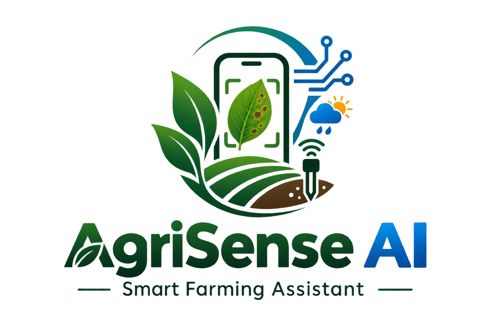
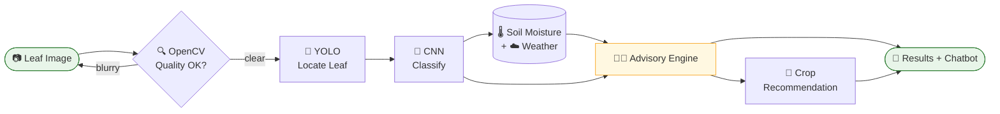
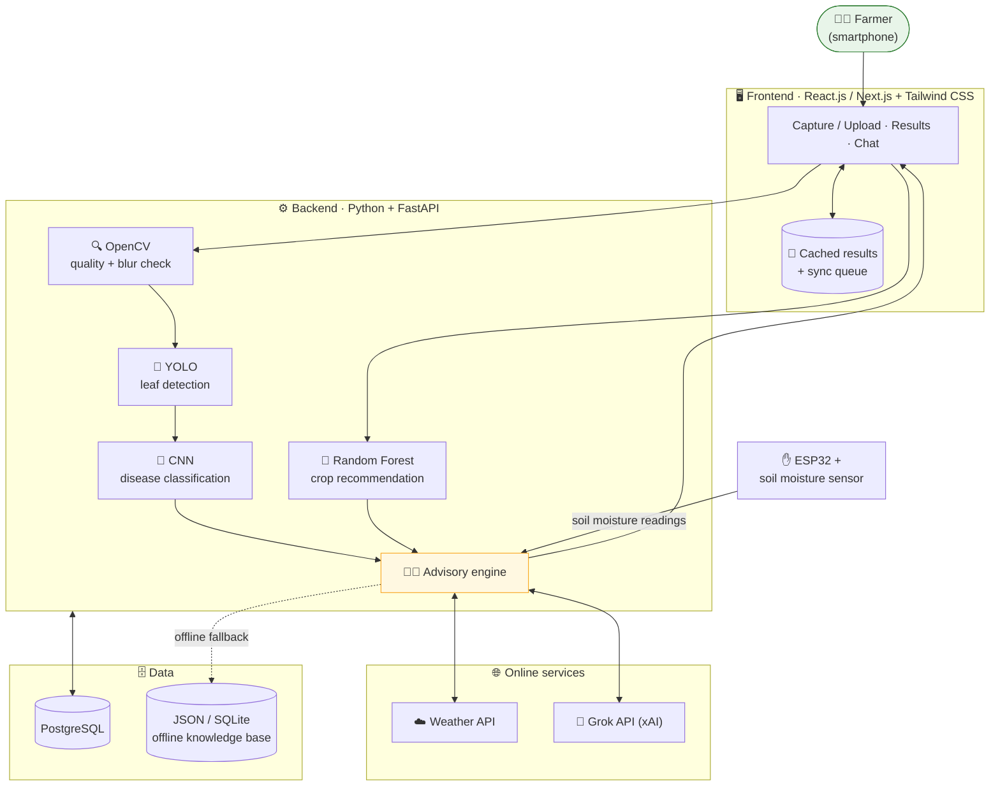

<div align="center">



# 🌱 AgriSense AI

### *From a single leaf to smarter farming decisions.*

**An AI + IoT smart farming companion that reads a crop leaf, feels the soil, checks the sky, and speaks the farmer's language, even when the network doesn't.**

<br/>


</div>

---

## 🧭 Quick Navigation

[🌾 Why AgriSense AI](#-why-agrisense-ai) · [🧬 Anatomy](#-the-anatomy-of-agrisense-ai) · [🍃 Journey of a Leaf](#-the-journey-of-a-leaf) · [✨ Features](#-features) · [🏗️ Architecture](#️-architecture) · [📴 Online vs Offline](#-works-when-the-network-doesnt) · [🛠️ Tech Stack](#️-tech-stack) · [📂 Repository Structure](#-repository-structure) · [📖 Glossary](#-plain-language-glossary) · [❓ FAQ](#-faq) · [🛡️ Responsible Use](#️-responsible-use) · [🔭 Horizon](#-horizon)

---

## 🌾 Why AgriSense AI

A farmer sees a spot on a leaf and has to decide: *is this serious, and what should I do about it?*

AgriSense AI exists to help answer that question **earlier**, in **plain language**, and with the **context of the field** (weather and soil), not just the leaf in isolation.

### 🎯 What we set out to do

| | Objective |
| :---: | :--- |
| 🔬 | Detect crop diseases from leaf images using AI |
| 🧑‍🌾 | Provide timely, understandable farming guidance |
| 🌡️ | Monitor soil moisture using IoT sensors |
| 🌦️ | Bring weather information into farming decisions |
| 🌾 | Recommend suitable crops from soil, weather, and regional data |
| 💬 | Support farmers through a multilingual chatbot |
| 📱 | Stay usable on low-end smartphones and unreliable networks |

---

## 🧬 The Anatomy of AgriSense AI

Think of AgriSense AI as a living system, where every part has a job.

| 🧩 Sense | 🛠️ Powered by | 💭 What it does |
| :--- | :--- | :--- |
| 👁️ **Eyes** | OpenCV + YOLO | Checks if the photo is sharp enough, then finds the leaf in the frame |
| 🧠 **Brain** | CNN (TensorFlow/Keras or PyTorch) | Decides if the leaf is healthy or shows a supported disease, with a confidence score |
| ✋ **Touch** | ESP32 + soil moisture sensor | Feels how much moisture is in the soil |
| ☁️ **Sky** | Weather API | Reads temperature, humidity, rainfall, and wind speed (where supported) |
| 🌱 **Roots** | Random Forest (Scikit-learn) | Suggests suitable crops from soil, weather, season, and regional data |
| 🗣️ **Voice** | Grok API (xAI) | Explains everything and answers questions in supported languages |
| 🗃️ **Memory** | JSON / SQLite knowledge base | Keeps essential guidance available when the internet is gone |

---

## 🍃 The Journey of a Leaf

Follow one photo through AgriSense AI:

```text
 📷  CAPTURE     The farmer captures or uploads a crop leaf image
  │
  ▼
 🔍  INSPECT     OpenCV checks image quality and detects blur
  │
  ▼
 🎯  LOCATE      YOLO identifies and locates the leaf
  │
  ▼
 🧠  DIAGNOSE    The CNN predicts the leaf's health condition
  │
  ▼
 🌍  CONTEXTUALIZE   Weather information + soil moisture readings are retrieved
  │
  ▼
 🧑‍🌾  ADVISE      The advisory engine combines what's available into guidance
  │
  ▼
 🌾  SUGGEST     The crop recommendation model proposes suitable crop options
  │
  ▼
 💬  CONVERSE    The farmer reviews results and asks follow-ups in the chatbot
```



---

## 🔄 What Goes In, What Comes Out

| 📥 Inputs | 📤 Outputs |
| :--- | :--- |
| 📷 Crop leaf image (captured or uploaded) | 🏷️ Predicted condition (healthy or supported disease) |
| 🌡️ Soil moisture readings from the ESP32 sensor | 📊 Confidence score |
| ☁️ Weather: temperature, humidity, rainfall, wind speed | 🧑‍🌾 Relevant farming guidance |
| 🌍 Soil characteristics, season, and regional data | 🌾 Suitable crop options |
| 💬 The farmer's questions | 🗣️ Chatbot answers in supported languages |

---

## ✨ Features

<details open>
<summary><b>🔬 AI-Based Disease Detection</b></summary>

<br/>

- Upload or capture crop leaf images
- **OpenCV** checks image quality and detects blur
- **YOLO** detects and locates the leaf
- A **CNN** classifies healthy leaves and supported diseases
- Displays the predicted condition and confidence score

</details>

<details open>
<summary><b>🧑‍🌾 Smart Farming Advisory</b></summary>

<br/>

- Combines disease predictions, weather information, and soil moisture readings
- Generates guidance using the **Grok API** and trusted agricultural information
- Provides basic recommendations from a local knowledge base when offline

</details>

<details open>
<summary><b>🌡️ IoT-Based Soil Monitoring</b></summary>

<br/>

- **ESP32** connected to a soil moisture sensor
- Collects soil moisture readings
- Readings support irrigation and crop management decisions

</details>

<details open>
<summary><b>🌦️ Weather Integration</b></summary>

<br/>

- Retrieves available weather information through a weather API
- Includes temperature, humidity, rainfall, and wind speed where supported
- Weather conditions make the guidance more relevant

</details>

<details open>
<summary><b>🌾 AI-Based Crop Recommendation</b></summary>

<br/>

- **Random Forest** machine learning model
- Considers available soil characteristics, weather, season, and regional data
- Presents suitable crop options to help farmers decide

</details>

<details open>
<summary><b>💬 Multilingual AI Chatbot</b></summary>

<br/>

- Farmers ask farming-related questions in supported languages
- **Grok API** powers online responses
- Predefined guidance from a local knowledge base when internet access is unavailable

</details>

<details open>
<summary><b>📴 Offline and Low-Network Support</b></summary>

<br/>

- Caches previously viewed results and essential information
- Gives access to saved farming guidance
- Queues selected requests for synchronization when connectivity returns
- Optimizes the interface for low-end smartphones and slower networks

</details>

---

## 🏗️ Architecture



---

## 📴 Works When the Network Doesn't

Rural connectivity is a design requirement, not an afterthought.

| | 🟢 Online | 🔴 Offline |
| :--- | :--- | :--- |
| **Weather** | Live weather API data | Previously cached information |
| **Advice & chat** | Grok API responses | Predefined guidance from the local knowledge base |
| **Results** | Fresh cloud-based AI predictions | Previously viewed results, cached |
| **Requests** | Sent immediately | Selected requests queued, synced when connectivity returns |

> ℹ️ **Note:** Live weather updates, Grok API responses, and cloud-based AI predictions require internet connectivity unless suitable offline alternatives are implemented.

---

## 🛠️ Tech Stack

| Layer | Technology | Role in AgriSense AI |
| :--- | :--- | :--- |
| 🖥️ Frontend | React.js / Next.js | The farmer-facing app |
| 🎨 UI Styling | Tailwind CSS | Interface styling, optimized for low-end phones |
| ⚙️ Backend | Python, FastAPI | Connects the AI models, data, and services |
| 🎯 Leaf Detection | YOLO | Finds the leaf in the image |
| 🧠 Disease Classification | CNN · TensorFlow/Keras or PyTorch | Classifies healthy vs. diseased leaves |
| 🔍 Image Processing | OpenCV | Image quality and blur checks |
| 🌾 Crop Recommendation | Random Forest · Scikit-learn | Suggests suitable crops |
| 🔌 IoT Hardware | ESP32 · Soil Moisture Sensor | Captures soil moisture readings |
| ☁️ Weather | Weather API | Temperature, humidity, rainfall, wind speed |
| 🤖 Chatbot & Advisory | Grok API (xAI) | Multilingual answers and guidance |
| 🗄️ Database | PostgreSQL | Main data storage |
| 📴 Offline Knowledge Base | JSON / SQLite | Guidance without internet |
| 🚀 Deployment | Vercel, Render | Hosting |
| 🔧 Version Control | Git, GitHub | Collaboration |

---

## 📂 Repository Structure

```text
IPBL2/
├── data/                         # Plant disease training & validation datasets
│   ├── dataset_combined/         # 11-class annotated leaf images
│   │   ├── train/                # Training samples by disease category
│   │   └── val/                  # Validation samples
│   └── README.md                 # Dataset documentation & class listing
├── scripts/                      # ML training, download & export utilities
│   ├── download_model.py         # Automated model weights downloader
│   ├── export_to_web.py          # TensorFlow.js converter for offline PWA
│   └── train_model.py            # CNN fine-tuning pipeline (EfficientNetB0)
├── server/                       # Backend REST API (Flask / Gunicorn)
│   ├── handlers/                 # Modular domain services
│   │   ├── __init__.py
│   │   ├── llm_handler.py        # Groq LLM prompt generation & advisory
│   │   └── model_handler.py      # Leaf preprocessing & CNN inference
│   ├── models/                   # Neural network weights
│   │   └── model.h5              # Trained model file
│   ├── __init__.py
│   └── app.py                    # API entrypoint, routes, and CORS setup
├── tests/                        # Automated tests & verification
│   ├── __init__.py
│   └── test_api.py               # Groq & backend API validation
├── web/                          # Frontend Progressive Web App (PWA)
│   ├── assets/                   # Static media assets
│   │   └── images/               # App imagery (logos, hero, illustrations)
│   ├── css/                      # Stylesheet system
│   │   └── style.css             # Glassmorphic UI & responsive layouts
│   ├── js/                       # Client-side scripts
│   │   ├── config.js             # API connection endpoint configuration
│   │   └── script.js             # UI routing, camera, i18n, IoT sensor logic
│   ├── config.js                 # Root runtime API configuration
│   ├── favicon.ico               # Browser favicon
│   ├── favicon.png               # High-res PWA icon
│   ├── index.html                # Single-page application UI
│   ├── manifest.json             # Web App Manifest for mobile installation
│   ├── package.json              # Frontend build scripts
│   ├── prepare_config.js         # Dynamic environment injector for Vercel
│   └── sw.js                     # Service Worker for offline asset caching
├── .gitignore                    # Git tracking rules
├── .python-version               # Python runtime version
├── Procfile                      # Cloud process declaration (Render/Heroku)
├── README.md                     # Project documentation
├── render.yaml                   # Render deployment specification
├── requirements.txt              # Python server dependencies
├── runtime.txt                   # Cloud deployment Python runtime
└── vercel.json                   # Vercel deployment & routing configuration
```

---

## 📖 Plain-Language Glossary

<details>
<summary><b>New to the tech? Tap to expand 👇</b></summary>

<br/>

| Term | In plain words |
| :--- | :--- |
| **CNN** (Convolutional Neural Network) | A kind of AI model that learns to recognize patterns in images, such as the spots and textures on a diseased leaf |
| **YOLO** ("You Only Look Once") | A fast object-detection model that finds *where* something is in a picture, here, the leaf |
| **OpenCV** | A widely used library for working with images, used here to check whether a photo is clear enough |
| **Random Forest** | A machine learning model made of many decision trees that vote together, used here to suggest crops |
| **ESP32** | A small, low-cost microcontroller board that can read sensors and connect to the internet |
| **Soil moisture sensor** | A sensor that measures how much water is in the soil |
| **FastAPI** | A Python framework for building the backend that connects everything |
| **Grok API** | An AI service from xAI used for the chatbot and advisory responses |
| **Confidence score** | How sure the model is about its prediction |

</details>

---

## ❓ FAQ

<details>
<summary><b>Does AgriSense AI replace an agricultural expert?</b></summary>

<br/>

No. It is designed to support farming decisions, not replace experts. Predictions are estimates and should be validated against real-world conditions.

</details>

<details>
<summary><b>Can it work without internet?</b></summary>

<br/>

Partly. Cached results, saved guidance, and a local knowledge base of basic recommendations remain available offline. Live weather, Grok API responses, and cloud-based AI predictions need a connection unless suitable offline alternatives are implemented.

</details>

<details>
<summary><b>Which crops and diseases does it detect?</b></summary>

<br/>

The supported ones. Coverage depends on what the models are trained on, and expanding to more crops and diseases is part of the [Horizon](#-horizon).

</details>

<details>
<summary><b>Why check the image before predicting?</b></summary>

<br/>

A blurry photo leads to unreliable predictions. OpenCV flags poor-quality images first so the models work from a clear leaf.

</details>

<details>
<summary><b>How does AgriSense AI know about my soil?</b></summary>

<br/>

An ESP32 board with a soil moisture sensor collects soil moisture readings, which are combined with weather information and the leaf prediction.

</details>

<details>
<summary><b>Can I use it on a low-end phone?</b></summary>

<br/>

That is a core goal. The interface is optimized for low-end smartphones and slower networks.

</details>

---

## 🛡️ Responsible Use

> **AgriSense AI is designed to support farming decisions, not replace agricultural experts.**

| ✅ AgriSense AI is | ❌ AgriSense AI is not |
| :--- | :--- |
| A decision-support tool | A replacement for agricultural experts |
| An early-warning helper for supported crop diseases | A guarantee of diagnosis |
| A source of guidance, informed by weather and soil data | A source of unverified treatment or pesticide advice |

- 🔎 AI predictions are **estimates** and should be validated against real-world conditions.
- 💊 Disease-specific treatments and pesticide recommendations should be based on **verified agricultural guidance**.

---

## 🔭 Horizon

Where AgriSense AI is headed:

- [ ] 🌾 Expand disease detection to support more crops and diseases
- [ ] 📸 Improve model performance using diverse, real-world agricultural images
- [ ] 📚 Add regional agricultural datasets and verified treatment recommendations
- [ ] 🌐 Expand language support
- [ ] 🔌 Introduce additional IoT sensors for environmental monitoring
- [ ] 📴 Develop more comprehensive offline AI capabilities

---

## 🌾 Expected Impact

| 🌱 For farmers | |
| :--- | :--- |
| ⏱️ | Earlier identification of supported crop diseases |
| 📖 | Better access to farming information |
| 💧 | Improved awareness of soil moisture and weather conditions |
| 🌾 | More informed crop selection |
| 🏡 | Easier access to agricultural guidance in rural areas |
| 🗣️ | Greater accessibility through multilingual and offline-friendly features |

---

<div align="center">

### 🌱 **AgriSense AI**

*From a single leaf to smarter farming decisions.*

Built with 💚 for the people who feed the world.

</div>