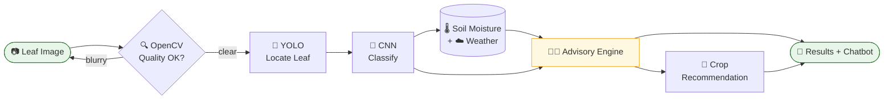
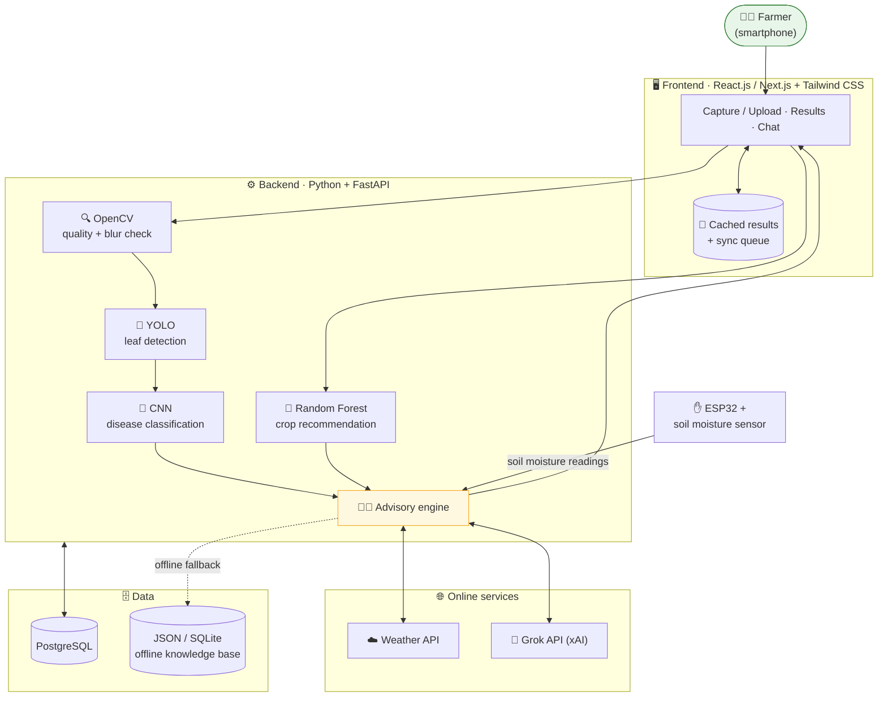
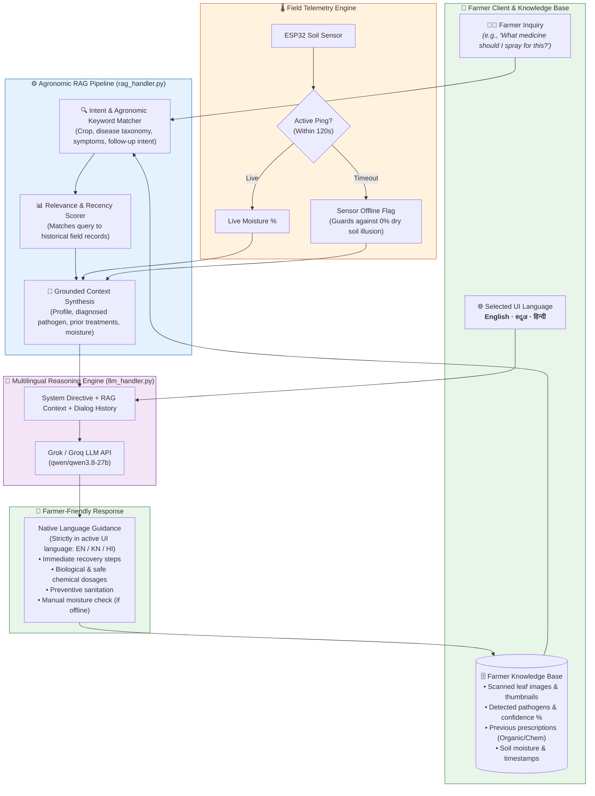

<div align="center">


# 🌱 AgriSense AI

### *From a single leaf to smarter farming decisions.*

**An AI + IoT smart farming companion that reads a crop leaf, feels the soil, checks the sky, and speaks the farmer's language, even when the network doesn't.**

<br/>


</div>

-------------------------------------------------------------------------------------------------------------

## 🧭 Quick Navigation

[🌾 Why AgriSense AI](#-why-agrisense-ai) · [🧬 Anatomy](#-the-anatomy-of-agrisense-ai) · [🍃 Journey of a Leaf](#-the-journey-of-a-leaf) · [✨ Features](#-features) · [🏗️ Architecture](#️-architecture) · [🧠 RAG Assistant](#-context-aware-rag-assistant-retrieval-augmented-generation) · [📴 Online vs Offline](#-works-when-the-network-doesnt) · [🛠️ Tech Stack](#️-tech-stack) · [⚡ Installation & How to Run](#-installation--how-to-run) · [📂 Repository Structure](#-repository-structure) · [📖 Glossary](#-plain-language-glossary) · [❓ FAQ](#-faq) · [🛡️ Responsible Use](#️-responsible-use) · [🔭 Horizon](#-horizon)

---------------------------------------------------------------------------------------------------------------

## 🌾 Why AgriSense AI

A farmer sees a spot on a leaf and has to decide: *is this serious, and what should I do about it?*

AgriSense AI exists to help answer that question **earlier**, in **plain language** which cannot be understand by the farmers, and with the **context of the field** (weather and soil), not just the leaf in isolation.

### 🎯 What we set out to do

| | Objective |
| :---: | :--- |
| 🔬 | Detect crop diseases from leaf images using AI |
| 🧑‍🌾 | Provide timely, understandable farming guidance |
| 🌡️ | Monitor soil moisture using IoT sensors |
| 🌦️ | Bring weather information into farming decisions |
| 🌾 | Recommend suitable crops from soil, weather, and regional data |
| 💬 | Support farmers through a multilingual chatbot |
| 📱 | Stay usable on low-end smartphones and unreliable networks |

--------------------------------------------------------------------------------------------------

## 🧬 The Anatomy of AgriSense AI

Think of AgriSense AI as a living system, where every part has a job.

| 🧩 Sense | 🛠️ Powered by | 💭 What it does |
| :--- | :--- | :--- |
| 👁️ **Eyes** | OpenCV + YOLO | Checks if the photo is sharp enough, then finds the leaf in the frame |
| 🧠 **Brain** | CNN (TensorFlow/Keras or PyTorch) | Decides if the leaf is healthy or shows a supported disease, with a confidence score |
| ✋ **Touch** | ESP32 + soil moisture sensor | Feels how much moisture is in the soil |
| ☁️ **Sky** | Weather API | Reads temperature, humidity, rainfall, and wind speed (where supported) |
| 🌱 **Roots** | Random Forest (Scikit-learn) | Suggests suitable crops from soil, weather, season, and regional data |
| 🗣️ **Voice & Memory** | Context-Aware RAG + Grok / Groq LLM API | Remembers user leaf scans, diagnoses, prescriptions, and soil telemetry; answers follow-ups across English, Kannada, and Hindi |
| 🗃️ **Knowledge Base** | LocalStorage + Hybrid BM25 / Semantic Retrieval | Keeps diagnosis records, images, and localized agronomic advice available online and offline |

-----------------------------------------------------------
-----------------------------------------------------------

## 🍃 The Journey of a Leaf

Follow one photo through AgriSense AI:

```text
 📷  CAPTURE     The farmer captures or uploads a crop leaf image
  │
  ▼
 🔍  INSPECT     OpenCV checks image quality and detects blur
  │
  ▼
 🎯  LOCATE      YOLO identifies and locates the leaf
  │
  ▼
 🧠  DIAGNOSE    The CNN predicts the leaf's health condition
  │
  ▼
 🌍  CONTEXTUALIZE   Weather information + soil moisture readings are retrieved
  │
  ▼
 🧑‍🌾  ADVISE      The advisory engine combines what's available into guidance
  │
  ▼
 🌾  SUGGEST     The crop recommendation model proposes suitable crop options
  │
  ▼
 💬  CONVERSE    The farmer reviews results and asks follow-ups in the chatbot
```



---------------------------------------------------------------------

## 🔄 What Goes In, What Comes Out

| 📥 Inputs | 📤 Outputs |
| :--- | :--- |
| 📷 Crop leaf image (captured or uploaded) | 🏷️ Predicted condition (healthy or supported disease) |
| 🌡️ Soil moisture readings from the ESP32 sensor | 📊 Confidence score |
| ☁️ Weather: temperature, humidity, rainfall, wind speed | 🧑‍🌾 Relevant farming guidance |
| 🌍 Soil characteristics, season, and regional data | 🌾 Suitable crop options |
| 💬 The farmer's questions | 🗣️ Chatbot answers in supported languages |

--------------------------------------------------------------------

## ✨ Features

<details open>
<summary><b>🔬 AI-Based Disease Detection</b></summary>

<br/>

- Upload or capture crop leaf images
- **OpenCV** checks image quality and detects blur
- **YOLO** detects and locates the leaf
- A **CNN** classifies healthy leaves and supported diseases
- Displays the predicted condition and confidence score

</details>

<details open>
<summary><b>🧑‍🌾 Smart Farming Advisory</b></summary>

<br/>

- Combines disease predictions, weather information, and soil moisture readings
- Generates guidance using the **Grok API** and trusted agricultural information
- Provides basic recommendations from a local knowledge base when offline

</details>

<details open>
<summary><b>🌡️ IoT-Based Soil Monitoring</b></summary>

<br/>

- **ESP32** connected to a soil moisture sensor
- Collects soil moisture readings
- Readings support irrigation and crop management decisions

</details>

<details open>
<summary><b>🌦️ Weather Integration</b></summary>

<br/>

- Retrieves available weather information through a weather API
- Includes temperature, humidity, rainfall, and wind speed where supported
- Weather conditions make the guidance more relevant

</details>

<details open>
<summary><b>🌾 AI-Based Crop Recommendation</b></summary>

<br/>

- **Random Forest** machine learning model
- Considers available soil characteristics, weather, season, and regional data
- Presents suitable crop options to help farmers decide

</details>

<details open>
<summary><b>🧠 Context-Aware Multilingual RAG Farming Assistant</b></summary>

<br/>

- **Personalized Knowledge Base**: Automatically retains each farmer's leaf scans, detected disease history, confidence ratings, exact treatment prescriptions (organic, chemical, recovery, prevention), and soil moisture readings.
- **RAG Retrieval Engine**: Employs an intelligent agronomic keyword and metadata relevance scorer (`server/handlers/rag_handler.py`) that ranks past diagnostic events and injects them as prompt context.
- **Seamless Follow-Up Memory**: Understands context-heavy questions (*"what medicine did you prescribe?"*, *"how is my plant?"*, *"is it cured?"*, *"can I water my field now?"*) without asking the farmer to repeat information already stored.
- **Strict Multilingual Mandate**: Seamlessly handles **English**, **Kannada (ಕನ್ನಡ)**, and **Hindi (हिन्दी)**. Regardless of what language the farmer types their inquiry in, AgriBot always composes its answer in the currently selected website language.
- **Adaptive IoT Telemetry Guard**: Automatically detects when the IoT soil sensor is offline (ping timeout > 120s) and prevents hallucinating false 0% bone-dry soil or inappropriate watering recommendations.
- **Farmer-Friendly Structure & Zero Hallucination**: Generates clear, compassionate, bulleted advice (recovery, organic alternatives, safe chemical dilutions, and preventive sanitation); explicitly communicates when reliable data is unavailable.
- **Offline Resilience**: Localized agronomic knowledge base provides offline diagnostic fallback in English, Kannada, and Hindi if connectivity is interrupted.

</details>

<details open>
<summary><b>📴 Offline and Low-Network Support</b></summary>

<br/>

- Caches previously viewed results and essential information
- Gives access to saved farming guidance
- Queues selected requests for synchronization when connectivity returns
- Optimizes the interface for low-end smartphones and slower networks

</details>

---

## 🏗️ Architecture



--------------------------------------------------------------------------------------

## 🧠 Context-Aware RAG Assistant (Retrieval-Augmented Generation)

General-purpose chatbots struggle in agriculture because they treat every farmer query in isolation, forget previously detected crop diseases, and lack access to ground-level soil telemetry. 

AgriSense AI incorporates an intelligent, **domain-specialized RAG (Retrieval-Augmented Generation)** knowledge pipeline designed specifically for precision farming.



### 🌟 Key RAG Capabilities

| Pillar | How it Works | Benefit for Farmers |
| :--- | :--- | :--- |
| **🧠 Memory & Grounding** | Stores each scan's diagnosis, confidence, moisture, and full recovery protocols. Scored on recency and keyword relevance when the farmer chats. | Farmers can ask follow-ups (*"how is my plant?"*, *"what spray did you suggest?"*) without re-typing their disease or uploading photos again. |
| **🌐 Strict Multilingual Parity** | The reasoning prompt enforces complete response composition in the active website language (**English**, **Kannada**, or **Hindi**), regardless of what language or mixed script the farmer used to type. | A farmer typing in English or Hinglish while viewing the site in Kannada receives an authoritative, natural answer entirely in **ಕನ್ನಡ ಲಿಪಿ**. |
| **🛡️ Adaptive IoT Telemetry Guard** | When the ESP32 sensor is disconnected or hasn't pinged for >120 seconds, the backend sets moisture to `None`/offline rather than defaulting to `0%`. | Prevents the dangerous assumption that the soil is bone dry, avoiding false irrigation advice that would worsen fungal infections like Apple Scab or Late Blight. |
| **📋 Actionable Prescription Structure** | Output formatted with clear bulleted sections: *Observation Summary*, *Immediate Recovery*, *Organic & Biological Solutions*, *Safe Chemical Dosage (with dilution and timing warnings)*, and *Preventive Measures*. | Simple, farmer-friendly, and actionable without technical jargon overload. |
| **🚫 Zero Hallucination Guarantee** | Grounded strictly in verified agricultural literature and the farmer's stored records. If data or reliable treatments are unknown, it communicates this transparently. | Protects farmers from fabricated chemical recipes or unscientific treatments. |

### 🗣️ Multilingual Dialogue In Action

<details>
<summary><b>🔍 Example 1: Kannada (ಕನ್ನಡ) Follow-up on Previous Scan</b></summary>

<br/>

- **Farmer Query (typed in English):** *"what medicine should I spray for my crop disease?"*
- **Retrieved Knowledge Context:** Farmer: Ramesh Kumar | Crop: Tomato | Scan: Tomato Early Blight (96.4% confidence) | Moisture: 38.5%
- **AgriSense AI Response (in Kannada):**
  > **ನಮಸ್ಕಾರ ರಮೇಶ್ ಕುಮಾರ್ ಸರ್,**  
  > ನಿಮ್ಮ ಟೊಮ್ಯಾಟೋ ಬೆಳೆಯಲ್ಲಿ **ಟೊಮ್ಯಾಟೋ ಇರ್ಲಿ ಬ್ಲೈಟ್ (Early Blight)** ರೋಗವು (96.4% ನಂಬಿಕೆ) ಪತ್ತೆಯಾಗಿದೆ. ನಿಮ್ಮ ಹಿಂದಿನ ಸ್ಕ್ಯಾನ್ ಆಧಾರದ ಮೇಲೆ ಈ ಕೆಳಗಿನ ಕ್ರಮಗಳನ್ನು ಕೈಗೊಳ್ಳಿ:  
  > 1. **ತಕ್ಷಣದ ಕ್ರಮ:** ಕೆಳಗಿನ ಹಳದಿ ಬಣ್ಣದ ಮತ್ತು ಕಂದು ಉಂಗುರದಂತಹ ಚುಕ್ಕೆಗಳಿರುವ ಎಲೆಗಳನ್ನು ಕತ್ತರಿಸಿ ಸುಟ್ಟುಹಾಕಿ.  
  > 2. **ರಾಸಾಯನಿಕ ಔಷಧಿ:** **Mancozeb 75 WP** ಶಿಲೀಂಧ್ರನಾಶಕವನ್ನು 1 ಲೀಟರ್ ನೀರಿಗೆ 2 ಗ್ರಾಂ ನಂತೆ ಬೆಳಗಿನ ವೇಳೆಯಲ್ಲಿ ಸಿಂಪಡಿಸಿ.  
  > 3. **ಜೈವಿಕ ಪರಿಹಾರ:** ವಾರಕ್ಕೊಮ್ಮೆ **Bacillus subtilis** ಸಿಂಪಡಿಸಿ.  
  > 4. **ಮುನ್ನೆಚ್ಚರಿಕೆ:** ಎಲೆಗಳಿಗೆ ನೀರು ತಾಗದಂತೆ ಡ್ರಿಪ್ ನೀರಾವರಿ ಬಳಸಿ ಮತ್ತು ಮಣ್ಣಿಗೆ ಮಲ್ಚಿಂಗ್ ಮಾಡಿ.

</details>

<details>
<summary><b>🔍 Example 2: Hindi (हिन्दी) Irrigation Telemetry Inquiry</b></summary>

<br/>

- **Farmer Query (typed in English):** *"is it safe to water my plants now?"*
- **Retrieved Knowledge Context:** Crop: Tomato | Disease: Early Blight | Live Moisture: 38.5%
- **AgriSense AI Response (in Hindi):**
  > **नमस्ते! आपके पिछले स्कैन के अनुसार टमाटर में इयरली ब्लाइट (Early Blight) की समस्या है और मिट्टी की नमी 38.5% है।**  
  > • **सिंचाई निर्णय:** अभी ऊपरी छिड़काव से पानी देना सुरक्षित नहीं है, क्योंकि पत्तियों पर नमी रहने से फफूंद तेजी से फैलती है।  
  > • **सुरक्षित तरीका:** केवल ड्रिप सिंचाई का उपयोग करें ताकि पानी सीधे जड़ों तक पहुंचे और पत्तियां सूखी रहें।  
  > • **समय:** यदि पानी देना आवश्यक हो, तो सुबह जल्दी दें ताकि दिन की धूप में पत्तियां तुरंत सूख जाएं।

</details>

<details>
<summary><b>🔍 Example 3: Adaptive Offline IoT Response (English)</b></summary>

<br/>

- **Farmer Query:** *"Should I irrigate my orchard today?"*
- **Telemetry Context:** ESP32 sensor offline (ping expired > 120s, moisture = `None`) | Disease: Apple Scab
- **AgriSense AI Response (in English):**
  > **Field Telemetry Notice:** The IoT soil moisture sensor is currently **Offline**.  
  > **Adaptive Recommendation:** Do not assume the soil is dry simply because the sensor is disconnected. Because **Apple Scab** thrives under persistent dampness and leaf wetness:  
  > 1. **Manual Check:** Inspect the top 2–3 inches of soil around the root zone manually.  
  > 2. **Pruning First:** Remove infected twigs and collect fallen leaves to reduce spores.  
  > 3. **Irrigate Only if Dry:** If the soil feels genuinely dry, apply water at the base in early morning; never wet the tree canopy.

</details>

--------------------------------------------------------------------------------------

## 📴 Works When the Network Doesn't

Rural connectivity is a design requirement, not an afterthought.

| | 🟢 Online | 🔴 Offline |
| :--- | :--- | :--- |
| **Weather** | Live weather API data | Previously cached information |
| **Advice & chat** | Grok API responses | Predefined guidance from the local knowledge base |
| **Results** | Fresh cloud-based AI predictions | Previously viewed results, cached |
| **Requests** | Sent immediately | Selected requests queued, synced when connectivity returns |

> ℹ️ **Note:** Live weather updates, Grok API responses, and cloud-based AI predictions require internet connectivity unless suitable offline alternatives are implemented.

-----------------------------------------------------------------------------------------

## 🛠️ Tech Stack

| Layer | Technology | Role in AgriSense AI |
| :--- | :--- | :--- |
| 🖥️ Frontend | React.js / Next.js | The farmer-facing app |
| 🎨 UI Styling | Tailwind CSS | Interface styling, optimized for low-end phones |
| ⚙️ Backend | Python, FastAPI | Connects the AI models, data, and services |
| 🎯 Leaf Detection | YOLO | Finds the leaf in the image |
| 🧠 Disease Classification | CNN · TensorFlow/Keras or PyTorch | Classifies healthy vs. diseased leaves |
| 🔍 Image Processing | OpenCV | Image quality and blur checks |
| 🌾 Crop Recommendation | Random Forest · Scikit-learn | Suggests suitable crops |
| 🔌 IoT Hardware | ESP32 · Soil Moisture Sensor | Captures soil moisture readings |
| ☁️ Weather | Weather API | Temperature, humidity, rainfall, wind speed |
| 🧠 Agronomic RAG Engine | Hybrid BM25 & Semantic Matcher (`rag_handler.py`) | Contextual retrieval of user diagnosis history, scans, and treatments |
| 🤖 Chatbot & LLM Reasoning | Grok / Groq API (`qwen/qwen3.8-27b`) | Context-aware, multilingual agronomic consultation in EN, KN, and HI |
| 🗄️ Database | PostgreSQL | Main data storage |
| 📴 Offline Knowledge Base | JSON / SQLite / LocalStorage | Scans, prescriptions & guidance without internet |
| 🚀 Deployment | Vercel, Render | Hosting |
| 🔧 Version Control | Git, GitHub | Collaboration |

-------------------------------------------------------------------------------------------------

<a id="-installation--how-to-run"></a>
## ⚡ Installation & How to Run

Follow this step-by-step guide to set up AgriSense AI locally, run the server and web interfaces, or connect the physical ESP32 IoT soil telemetry node.

### 📋 Prerequisites

Before proceeding, ensure your development machine has the following tools installed:

| Component | Minimum Version | Purpose |
| :--- | :--- | :--- |
| **Python** | `3.10` or `3.11` *(tested on Python 3.11.5)* | Backend server, ML inference & processing scripts |
| **Git** | `2.x+` | Source code management |
| **Modern Web Browser** | Chrome, Edge, Safari, Firefox | PWA interface, WebRTC camera capture & telemetry charts |
| *(Optional)* **Arduino IDE** | `2.x+` | Flashing telemetry firmware to ESP32 board |
| *(Optional)* **Groq Cloud API Key** | Free tier available | Online AI Agronomist chatbot ([Get API Key](https://console.groq.com/)) |

---

### 📦 Step 1: Clone the Repository

Clone the project repository to your local system and enter the project directory:

```bash
git clone https://github.com/Dheeraj-del-cyber/IPBL.git
cd IPBL2
```

---

### 🐍 Step 2: Set Up Python Virtual Environment

It is recommended to use an isolated Python virtual environment to manage dependencies cleanly.

#### On Windows (PowerShell / Command Prompt):
```powershell
# Create virtual environment
python -m venv venv

# Activate virtual environment (PowerShell)
.\venv\Scripts\Activate.ps1

# (Or if using CMD instead)
# .\venv\Scripts\activate.bat
```

> **Note for Windows Users:** If PowerShell displays an execution policy error, enable script execution for your session by running: `Set-ExecutionPolicy -ExecutionPolicy RemoteSigned -Scope CurrentUser`.

#### On Linux / macOS:
```bash
# Create virtual environment
python3 -m venv venv

# Activate virtual environment
source venv/bin/activate
```

---

### 📥 Step 3: Install Dependencies

With the virtual environment activated, install all required packages:

```bash
pip install --upgrade pip
pip install -r requirements.txt
```

*(This installs Flask, Flask-CORS, TensorFlow CPU, OpenCV Headless, Pillow, NumPy, Requests, and python-dotenv).*

---

### ⚙️ Step 4: Configure Environment Variables

The server loads environment configurations from `server/.env`.

Verify or configure [`server/.env`](file:///c:/Users/Dheeraj/OneDrive/Videos/Music/Desktop/HACKATHONS/IPBL2/server/.env):

```env
# Groq Cloud API for Conversational Agronomist Chatbot
GROQ_API_KEY=your_groq_api_key_here
GROQ_MODEL=qwen/qwen3.8-27b

# Server Networking & Execution
PORT=5000
FLASK_DEBUG=0
MAX_CONTENT_LENGTH=8388608
```

> 💡 **Note:** If `GROQ_API_KEY` is omitted, the application will automatically fall back to the built-in offline agronomic rule-engine for diagnosis explanations and crop planning advice.

---

### 🚀 Step 5: Running the Application

You can run AgriSense AI in three convenient modes depending on your workflow:

#### Mode A: Full-Stack Local Server (Recommended for Development)
This mode runs the Python Flask server locally. The Flask backend handles CNN disease classification, crop recommendation, IoT telemetry ingestion, and serves the static web UI directly.

1. **Configure Web Client for Localhost:**
   Open [`web/config.js`](file:///c:/Users/Dheeraj/OneDrive/Videos/Music/Desktop/HACKATHONS/IPBL2/web/config.js) and point the API base to your local server:
   ```javascript
   window.API_BASE = "http://127.0.0.1:5000";
   ```
   *(Or leave empty / commented out to allow automatic origin detection).*

2. **Launch the Flask Application Server:**
   ```bash
   python server/app.py
   ```
   *(TensorFlow initializes and model weights are cached within 3–5 seconds).*

3. **Access in Your Web Browser:**
   Navigate to:
   ```
   http://localhost:5000
   ```
   You now have access to the full operations hub, foliar disease camera scanner, cultivar planner, and live IoT telemetry visualizer!

---

#### Mode B: Lightweight Frontend-Only (Connected to Cloud Render API)
If you prefer not to run Python or TensorFlow on your local machine, the frontend can connect directly to the live cloud-deployed backend on Render.

1. **Verify Cloud Target in `web/config.js`:**
   ```javascript
   window.API_BASE = "https://ipbl-p70f.onrender.com";
   ```

2. **Launch the Frontend:**
   You can serve the web client using any simple static file server:
   ```bash
   # Using Python's built-in HTTP server
   python -m http.server 3000 --directory web
   ```
   *(Alternatively, open [`web/index.html`](file:///c:/Users/Dheeraj/OneDrive/Videos/Music/Desktop/HACKATHONS/IPBL2/web/index.html) directly with the VS Code **Live Server** extension, or double-click `web/index.html` in your file explorer).*

3. **Navigate to:**
   ```
   http://localhost:3000
   ```

---

#### Mode C: Connect the ESP32 IoT Soil Moisture Node
To stream real-time soil moisture telemetry into the web dashboard from physical soil:

1. **Hardware Pin Connections:**
   - Connect the **VCC** pin of the Capacitive Soil Moisture Sensor to **3.3V** or **5V** on the ESP32.
   - Connect the **GND** pin of the sensor to **GND** on the ESP32.
   - Connect the **Analog Signal (AOUT)** pin to **GPIO 36 (VP)** on the ESP32.
   - Connect the ESP32 to your PC via a Micro-USB data cable.

2. **Configure the Firmware:**
   Open [`iot/esp32_firmware/esp32_firmware.ino`](file:///c:/Users/Dheeraj/OneDrive/Videos/Music/Desktop/HACKATHONS/IPBL2/iot/esp32_firmware/esp32_firmware.ino) in the **Arduino IDE**:
   ```cpp
   // Set your Wi-Fi credentials
   const char* WIFI_SSID     = "YOUR_WIFI_NAME";
   const char* WIFI_PASSWORD = "YOUR_WIFI_PASSWORD";

   // Target Server Endpoint (Render Cloud or Local IP)
   const char* SERVER_URL    = "https://ipbl-p70f.onrender.com/update_moisture";
   // For local development on the same Wi-Fi, use: "http://<YOUR_PC_IP>:5000/update_moisture"
   ```

3. **Flash the Node:**
   - In Arduino IDE, go to **Tools → Board** → select `ESP32 Dev Module`.
   - Select your USB COM Port under **Tools → Port** (e.g., `COM3` on Windows, `/dev/ttyUSB0` on Linux).
   - Set **Tools → Upload Speed** to `115200` *(recommended to prevent serial buffer drops during flash)*.
   - Click **Upload**.

4. **Verify Live Stream:**
   - Open **Tools → Serial Monitor** at `115200 baud`.
   - The ESP32 will print Wi-Fi connection status, raw ADC values, calculated moisture percentages, and HTTP response codes.
   - Switch to the **IoT Telemetry** screen on the web interface to view the live fluid wave indicator and historical charts updating in real time.

---

### 🧪 Step 6: Automated Testing & API Verification

You can verify server health and external API connectivity with the built-in testing script:

```bash
python tests/test_api.py
```

To manually verify the IoT moisture ingestion API via CLI:

```bash
# On Windows (PowerShell)
Invoke-RestMethod -Uri "http://127.0.0.1:5000/update_moisture" -Method Post -ContentType "application/json" -Body '{"moisture": 52.4}'
Invoke-RestMethod -Uri "http://127.0.0.1:5000/get_moisture"

# On Linux / macOS (cURL)
curl -X POST http://127.0.0.1:5000/update_moisture -H "Content-Type: application/json" -d "{\"moisture\": 52.4}"
curl http://127.0.0.1:5000/get_moisture
```

-------------------------------------------------------------------------------------------------

## 📂 Repository Structure

```text
IPBL2/
├── data/                         # Plant disease training & validation datasets
│   ├── dataset_combined/         # 11-class annotated leaf images
│   │   ├── train/                # Training samples by disease category
│   │   └── val/                  # Validation samples
│   └── README.md                 # Dataset documentation & class listing
├── iot/                          # Embedded telematics & sensor firmware
│   └── esp32_firmware/           # Arduino firmware for ESP32 capacitive sensor
│       └── esp32_firmware.ino    # Real-time HTTPS telemetry publisher
├── scripts/                      # ML training, download & export utilities
│   ├── download_model.py         # Automated model weights downloader
│   ├── export_to_web.py          # TensorFlow.js converter for offline PWA
│   └── train_model.py            # CNN fine-tuning pipeline (EfficientNetB0)
├── server/                       # Backend REST API (Flask / Gunicorn)
│   ├── handlers/                 # Modular domain services
│   │   ├── __init__.py
│   │   ├── llm_handler.py        # Groq LLM prompt generation & advisory
│   │   ├── model_handler.py      # Leaf preprocessing & CNN inference
│   │   └── rag_handler.py        # Agronomic RAG retrieval & context scoring
│   ├── models/                   # Neural network weights
│   │   └── model.h5              # Trained model file
│   ├── __init__.py
│   └── app.py                    # API entrypoint, routes, and CORS setup
├── tests/                        # Automated tests & verification
│   ├── __init__.py
│   └── test_api.py               # Groq & backend API validation
├── web/                          # Frontend Progressive Web App (PWA)
│   ├── assets/                   # Static media assets
│   │   └── images/               # App imagery (logos, hero, illustrations)
│   ├── css/                      # Stylesheet system
│   │   └── style.css             # Glassmorphic UI & responsive layouts
│   ├── js/                       # Client-side scripts
│   │   ├── config.js             # API connection endpoint configuration
│   │   └── script.js             # UI routing, camera, i18n, IoT sensor logic
│   ├── config.js                 # Root runtime API configuration
│   ├── favicon.ico               # Browser favicon
│   ├── favicon.png               # High-res PWA icon
│   ├── index.html                # Single-page application UI
│   ├── manifest.json             # Web App Manifest for mobile installation
│   ├── package.json              # Frontend build scripts
│   ├── prepare_config.js         # Dynamic environment injector for Vercel
│   └── sw.js                     # Service Worker for offline asset caching
├── .gitignore                    # Git tracking rules
├── .python-version               # Python runtime version
├── Procfile                      # Cloud process declaration (Render/Heroku)
├── README.md                     # Project documentation
├── render.yaml                   # Render deployment specification
├── requirements.txt              # Python server dependencies
├── runtime.txt                   # Cloud deployment Python runtime
└── vercel.json                   # Vercel deployment & routing configuration
```

--------------------------------------------------------------------------------------------------------------------

## 📖 Plain-Language Glossary

<details>
<summary><b>New to the tech? Tap to expand 👇</b></summary>

<br/>

| Term | In plain words |
| :--- | :--- |
| **CNN** (Convolutional Neural Network) | A kind of AI model that learns to recognize patterns in images, such as the spots and textures on a diseased leaf |
| **YOLO** ("You Only Look Once") | A fast object-detection model that finds *where* something is in a picture, here, the leaf |
| **OpenCV** | A widely used library for working with images, used here to check whether a photo is clear enough |
| **Random Forest** | A machine learning model made of many decision trees that vote together, used here to suggest crops |
| **ESP32** | A small, low-cost microcontroller board that can read sensors and connect to the internet |
| **Soil moisture sensor** | A sensor that measures how much water is in the soil |
| **FastAPI** | A Python framework for building the backend that connects everything |
| **Grok API** | An AI service from xAI used for the chatbot and advisory responses |
| **RAG** (Retrieval-Augmented Generation) | A precision AI method that retrieves a farmer's past leaf scans, treatments, and live soil sensor data to inject as context into the prompt, enabling accurate follow-up conversations without repeating information |
| **Confidence score** | How sure the model is about its prediction |

</details>

--------------------------------------------------------------------------------------------------------------

## ❓ FAQ

<details>
<summary><b>Does AgriSense AI replace an agricultural expert?</b></summary>

<br/>

No.It is designed to support farming decisions, not replace experts. Predictions are estimates and should be validated against real-world conditions.

</details>

<details>
<summary><b>Can it work without internet?</b></summary>

<br/>

Partly. Cached results, saved guidance, and a local knowledge base of basic recommendations remain available offline. Live weather, Grok API responses, and cloud-based AI predictions need a connection unless suitable offline alternatives are implemented.

</details>

<details>
<summary><b>Which crops and diseases does it detect?</b></summary>

<br/>

The supported ones. Coverage depends on what the models are trained on, and expanding to more crops and diseases is part of the [Horizon](#-horizon).

</details>

<details>
<summary><b>Why check the image before predicting?</b></summary>

<br/>

A blurry photo leads to unreliable predictions. OpenCV flags poor-quality images first so the models work from a clear leaf.

</details>

<details>
<summary><b>How does AgriSense AI know about my soil?</b></summary>

<br/>

An ESP32 board with a soil moisture sensor collects soil moisture readings, which are combined with weather information and the leaf prediction.

</details>

<details>
<summary><b>Can I use it on a low-end phone?</b></summary>

<br/>

That is a core goal. The interface is optimized for low-end smartphones and slower networks.

</details>

---

## 🛡️Responsible Use

> **AgriSense AI is designed to support farming decisions, not replace agricultural experts.**

| ✅ AgriSense AI is | ❌ AgriSense AI is not |
| :--- | :--- |
| A decision-support tool | A replacement for agricultural experts |
| An early-warning helper for supported crop diseases | A guarantee of diagnosis |
| A source of guidance, informed by weather and soil data | A source of unverified treatment or pesticide advice |

- 🔎 AI predictions are **estimates** and should be validated against real-world conditions.
- 💊 Disease-specific treatments and pesticide recommendations should be based on **verified agricultural guidance**.

--------------------------------------------------------------------------------------

## 🔭 Horizon

Where AgriSense AI is headed:

- [ ] 🌾 Expand disease detection to support more crops and diseases
- [ ] 📸 Improve model performance using diverse, real-world agricultural images
- [ ] 📚 Add regional agricultural datasets and verified treatment recommendations
- [ ] 🌐 Expand language support
- [ ] 🔌 Introduce additional IoT sensors for environmental monitoring
- [ ] 📴 Develop more comprehensive offline AI capabilities

------------------------------------------------------------------------------------------------

## 🌾 Expected Impact

| 🌱 For farmers | |
| :--- | :--- |
| ⏱️ | Earlier identification of supported crop diseases |
| 📖 | Better access to farming information |
| 💧 | Improved awareness of soil moisture and weather conditions |
| 🌾 | More informed crop selection |
| 🏡 | Easier access to agricultural guidance in rural areas |
| 🗣️ | Greater accessibility through multilingual and offline-friendly features |

-------------------------------------------------------------------------------------------------------

<div align="center">

### 🌱 **AgriSense AI**

*From a single leaf to smarter farming decisions.*

Built with 💚 for the people who feed the world.

</div>
